<a href="https://github.com/AntelopeJS/antelopejs"></a>

<div align="center">

# AntelopeJS interface registry

<a href="./LICENSE"></a> <a href="https://discord.gg/g4pFt6eXqu"></a> <a href="https://framework.antelopejs.com/docs/module-development/interface-registry"></a> <a href="https://github.com/AntelopeJS/antelopejs"></a>

**The interface registry the ajs CLI reads to find which modules implement an interface.**

[Documentation](https://framework.antelopejs.com/docs/module-development/interface-registry) · [All interfaces and providers](https://github.com/AntelopeJS/antelopejs#ecosystem)

</div>

The catalog the `ajs` CLI reads to find which modules implement an interface. It holds metadata only: the interface packages and their implementations live on npm.

## What it does

- `ajs project modules install` finds the interfaces a project imports without an implementation, and offers the modules this registry lists for them.
- `ajs module init` offers the starred interfaces of this registry when it scaffolds a module, and the templates listed here.
- `ajs project init` also offers complete project templates, including **DMS Starter**, **DMS Connect Demo**, **DMS Demo**, and **DMS Adonis**.
- Each interface has a folder under `interfaces/` with a `manifest.json`: a description, the interface package and the modules that implement it.
- The root `manifest.json` maps each interface package to its folder and lists the starred interfaces and the project templates.

## Interfaces

| Interface                                                                                   | Package                                     | Modules listed                                                         |
| ------------------------------------------------------------------------------------------- | ------------------------------------------- | ---------------------------------------------------------------------- |
| [API](https://interfaces.antelopejs.com/docs/api)                                           | `@antelopejs/interface-api`                 | `@antelopejs/api`                                                      |
| [API Util](https://interfaces.antelopejs.com/docs/api-util)                                 | `@antelopejs/interface-api-util`            | `@antelopejs/api`                                                      |
| [Auth](https://interfaces.antelopejs.com/docs/auth)                                         | `@antelopejs/interface-auth`                | `@antelopejs/auth-jwt`                                                 |
| [Core](https://interfaces.antelopejs.com/docs/core)                                         | `@antelopejs/interface-core`                | none: `@antelopejs/core` provides it                                   |
| [Data API](https://interfaces.antelopejs.com/docs/data-api)                                 | `@antelopejs/interface-data-api`            | `@antelopejs/data-api`                                                 |
| [Database](https://interfaces.antelopejs.com/docs/database)                                 | `@antelopejs/interface-database`            | `@antelopejs/postgres`, `@antelopejs/mongodb`, `@antelopejs/rethinkdb` |
| [Database Catalog](https://github.com/AntelopeJS/interface-database-catalog/tree/main/docs) | `@antelopejs/interface-database-catalog`    | `@antelopejs/postgres`, `@antelopejs/mongodb`, `@antelopejs/rethinkdb` |
| [Database Decorators](https://interfaces.antelopejs.com/docs/database-decorators)           | `@antelopejs/interface-database-decorators` | `@antelopejs/database-decorators`                                      |
| [Email](https://github.com/AntelopeJS/interface-email/tree/main/docs)                       | `@antelopejs/interface-email`               | `@antelopejs/nodemailer`, `@antelopejs/brevo`                          |
| [File Storage](https://github.com/AntelopeJS/interface-file-storage/tree/main/docs)         | `@antelopejs/interface-file-storage`        | `@antelopejs/file-storage-s3`, `@antelopejs/file-storage-local`        |
| [Logging](https://interfaces.antelopejs.com/docs/core/logging)                              | `@antelopejs/interface-core`                | none: `@antelopejs/core` provides it                                   |
| [MongoDB](https://interfaces.antelopejs.com/docs/mongodb)                                   | `@antelopejs/interface-mongodb`             | `@antelopejs/mongodb`                                                  |
| [Redis](https://interfaces.antelopejs.com/docs/redis)                                       | `@antelopejs/interface-redis`               | `@antelopejs/redis`                                                    |
| [Redis Scheduler](https://interfaces.antelopejs.com/docs/redis-scheduler)                   | `@antelopejs/interface-redis-scheduler`     | `@antelopejs/redis`                                                    |
| [RethinkDB](https://interfaces.antelopejs.com/docs/rethinkdb)                               | `@antelopejs/interface-rethinkdb`           | `@antelopejs/rethinkdb`                                                |
| [Stripe](https://interfaces.antelopejs.com/docs/stripe)                                     | `@antelopejs/interface-stripe`              | `@antelopejs/stripe`                                                   |

Registration does not publish an npm package or deploy its documentation. The
public documentation site has its own source registry in
`AntelopeJS/antelope-web`; add a source there when a public interface is ready
to appear on the site. Private interfaces are not listed in this public
registry.

Each interface owns its reference in its package's `docs/` directory. For DMS
monorepos this is `packages/interface-dms-*/docs/`; the
[DMS documentation](https://dms.antelopejs.com/docs/interfaces) links those
contracts separately from the runtime guides. This registry is not an inventory
of every package that can participate in AntelopeJS.

The catalog also includes these contracts:

| Interface | Package | Modules listed |
| --- | --- | --- |
| DMS | `@antelopejs/interface-dms` | `@antelopejs/dms` |
| DMS Automation | `@antelopejs/interface-dms-automation` | `@antelopejs/dms-automation` |
| DMS Builder | `@antelopejs/interface-dms-builder` | `@antelopejs/dms-builder` |
| DMS Mailing | `@antelopejs/interface-dms-mailing` | `@antelopejs/dms-mailing` |
| DMS Marketing | `@antelopejs/interface-dms-marketing` | `@antelopejs/dms-marketing` |
| DMS Media | `@antelopejs/interface-dms-media` | `@antelopejs/dms-media` |
| DMS SaaS | `@antelopejs/interface-dms-saas` | `@antelopejs/dms-saas` |

## Use it

The CLI reads this repository by default. Resolve the missing implementations of a project from its folder:

```bash
npx @antelopejs/core project modules install
```

### Start a DMS project with Docker

```bash
npx @antelopejs/core project init my-app --template dms-starter --yes
cd my-app
docker compose up
```

This template runs the DMS, the Builder, and the AI assistant with no sample data. Docker Compose also starts the MongoDB that the DMS needs. When the dashboard is ready on <http://localhost:3001>, open the onboarding address that the `dms` log prints after `[DMS] No owner exists yet`, and create the first administrator. See the [template README](https://github.com/AntelopeJS/template-dms#readme).

### Try the Connect flow on a sample database

```bash
npx @antelopejs/core project init my-app --template dms-connect-demo --yes
cd my-app
docker compose up
```

This template runs the same DMS with a PostgreSQL sample database. `docker compose --profile mongodb up` or `docker compose --profile rethinkdb up` also starts a MongoDB or RethinkDB sample with the same data. Open the onboarding address that the `dms` log prints, create the first administrator, then connect the sample in the Builder. See the [template README](https://github.com/AntelopeJS/template-dms-connect-demo#readme).

### Start a DMS project with the demo application

```bash
npx @antelopejs/core project init my-app --template dms-demo --yes
cd my-app
pnpm dev
```

The demo requires Node.js 24, pnpm and a running MongoDB instance. Run
`pnpm frontend:dev` in a second terminal. Then open the onboarding address that
the backend console prints, and create the first administrator. See the
[template README](https://github.com/AntelopeJS/template-dms-demo#readme)
for configuration.

`modules install` resolves missing contracts; it is not a menu of every DMS
feature. Modules such as `dms-ai`, `dms-api`, `dms-database` and `dms-lang`
do not declare an interface implementation. The demo already configures them.
Installing an interface package alone does not configure a working dashboard.

### Start a DMS project inside AdonisJS

```bash
npx @antelopejs/core project init my-app --template dms-adonis --yes
cd my-app
cp .env.example .env
node ace generate:key
pnpm dev
```

This template runs the DMS embedded in an AdonisJS 6 application. Build and
start the dashboard in a second terminal, then open the onboarding address that
the backend console prints. See the
[template README](https://github.com/AntelopeJS/template-dms-adonis#readme).

### Start a reusable DMS module

```bash
npx @antelopejs/core module init my-module --template dms-module-typescript --pm pnpm --yes
cd my-module
pnpm services:up
pnpm dev
```

Run `pnpm frontend:dev` in a second terminal. This template contains a reusable
module, one Vue component and a `playground/` project. Docker Compose supplies
MongoDB and Mailpit; existing local services also work. See the
[module template README](https://github.com/AntelopeJS/template-module-dms#readme).
It belongs in `templates`, not `projectTemplates`: it is a module with a
development host, not a complete application.

### Project template metadata

The root `projectTemplates` array holds complete projects. The CLI offers
them only in `project init`, alongside the module templates in `templates`.
Older CLIs ignore `projectTemplates`, so they cannot offer a project they
would incorrectly overwrite. Keep complete projects out of `templates`.

Both arrays use the required `name`, `repository` and `branch` fields and
these optional fields:

- `description`: a hint in the template selector, including prerequisites.
- `packageManager`: require this package manager and skip its prompt.
- `install`: `false` when the template installs its own dependencies, for
  example inside its container. The CLI then copies the template and
  installs nothing on the host, so the package manager does not have to be
  installed. Absent or `true` installs the dependencies on the host.
- `nextSteps`: commands and optional descriptions displayed after creation;
  the CLI does not execute these commands automatically.

`--template` accepts the `name` or its kebab-case slug, such as
`dms-connect-demo` for **DMS Connect Demo**. Template slugs require the
`@antelopejs/core` release that ships them. Earlier
releases accept only the `name`, such as `--template "DMS Connect Demo"`.

## Add an interface or an implementation

Create `interfaces/<name>/manifest.json`, or add your module to the `modules` array of an existing one:

```json
{
  "description": "Payment processing interface",
  "package": "@antelopejs/interface-payment",
  "modules": [
    {
      "name": "payment-stripe",
      "source": {
        "type": "package",
        "package": "@acme/payment-stripe",
        "version": "latest"
      }
    }
  ]
}
```

For a new interface, also map its package to the folder in the `interfaces` object of the root `manifest.json`. The [interface registry guide](https://framework.antelopejs.com/docs/module-development/interface-registry) describes every field.

## Contributing

Read [CONTRIBUTING.md](./CONTRIBUTING.md), then open a pull request with your manifest change.

## Part of AntelopeJS

This registry belongs to [AntelopeJS](https://github.com/AntelopeJS/antelopejs), the TypeScript framework where modules depend on contracts and the application chooses the provider. The open-source back office [AntelopeJS DMS](https://github.com/AntelopeJS/dms) is built on it.

## License

[Apache-2.0](./LICENSE)
